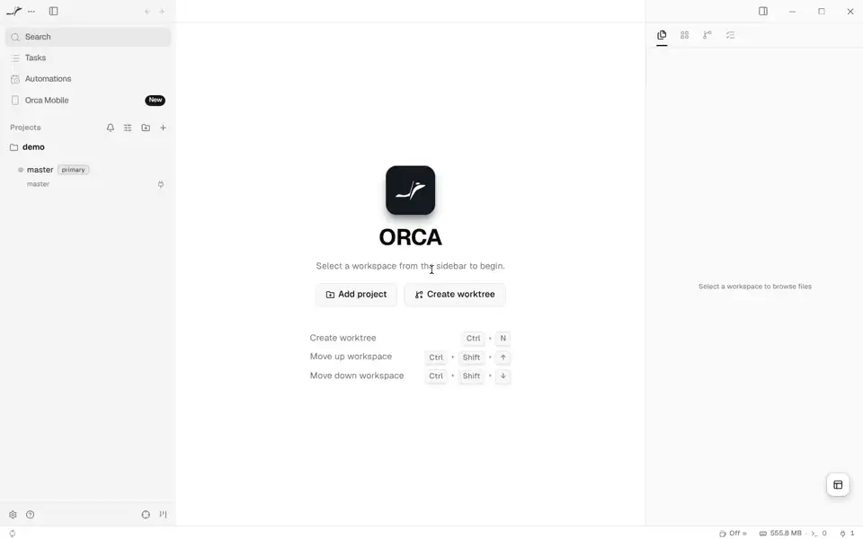

# Demo

Orca from this flake, in a NixOS VM, runs an agent end to end with no
network and no API key.



[Full video (mp4)](demo/demo.mp4) · [last frame](demo/shot.png)

## What happens

1. Alice's Orca (`orca-ide` with OpenCode, updater off) opens under Xvfb.
2. `orca-ide repo add` adds `~/demo`, a git repository whose
   `opencode.json` points OpenCode at a local model server.
3. `orca-ide agent launch --agent opencode --prompt "write hello.txt"
   --focus` starts OpenCode in an Orca terminal.
4. The model server is the stub from `tests/stub`: it replays a recorded
   answer, a tool call that writes `hello.txt`. OpenCode runs the tool;
   the file appears in Orca's file panel.

Orca's first-run screens (onboarding, tips, tours, telemetry notice) are
skipped by seeding its state, so the video shows the work only. Stretches
where nothing changes are cut: OpenCode takes about 77 s from launch to
the file, the video 10 s.

## Re-record

The video is the output of `checks.x86_64-linux.agents-stub`, which needs
an x86_64-linux host with KVM. In the dev shell:

```sh
scripts/demo-assets.sh                                # this host builds it
scripts/demo-assets.sh ssh-ng://root@builder.example  # a remote host does
```

It replaces the files in `docs/demo/` and commits them alone. The check
runs again only when its inputs change (a bump, the stub, the scripts),
so the same inputs commit nothing.
